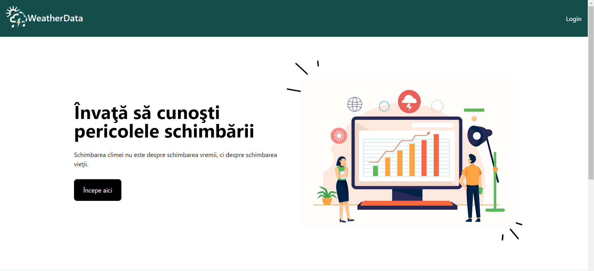
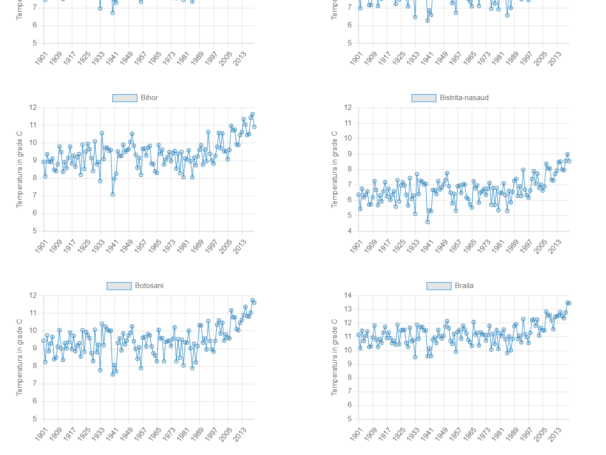
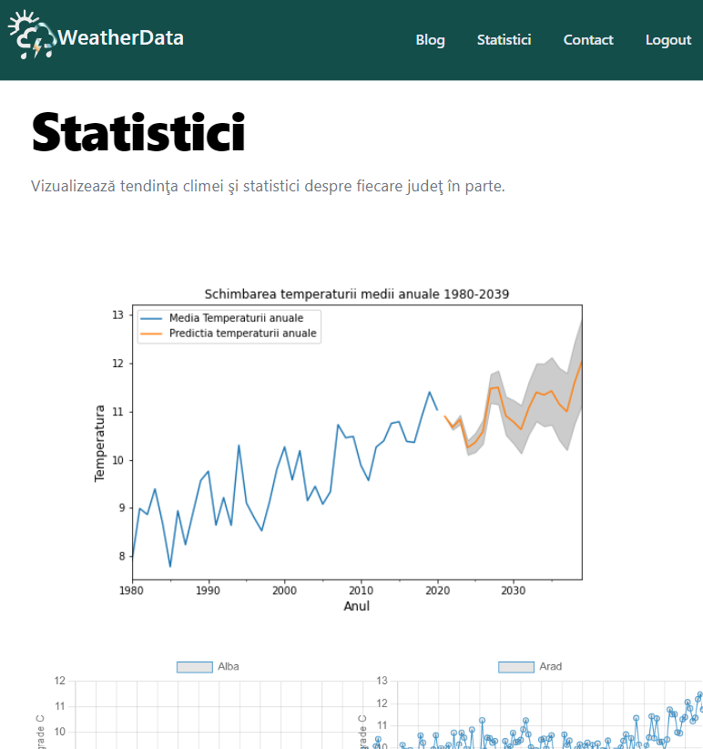
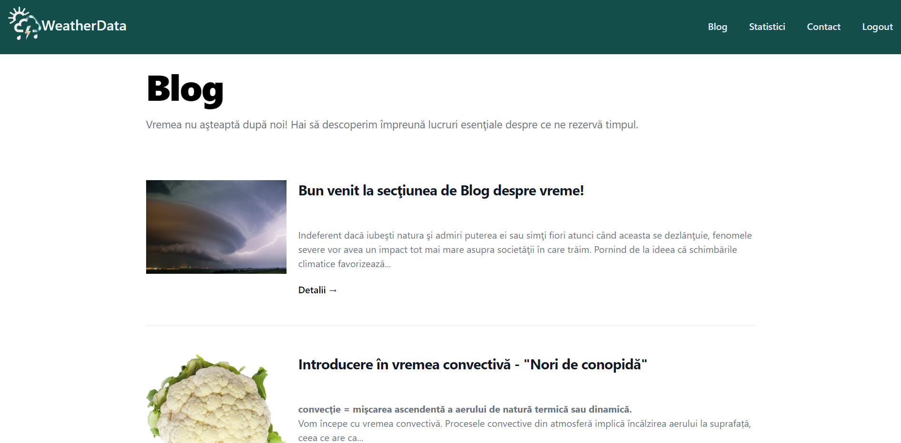
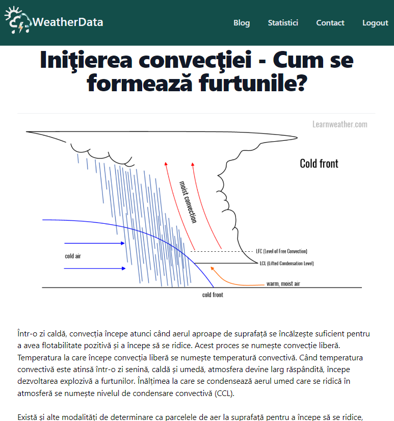

# WeatherData Romania 🌦️

A Flask web app that visualises 120 years of temperature data for every Romanian county and forecasts the climate trend with an ARIMA time-series model. Built as my **Bachelor's thesis** in Computer Science (2022), on *tools for processing large datasets in the context of machine learning*.



## What it does

- **County statistics** – interactive line charts (Chart.js) of mean annual temperature for all 42 counties, 1901–2020, served from a SQLite database (5,040 records).
- **Climate forecast** – an ARIMA(1,0,2) model with a Box-Cox transform, tuned by grid search and checked with walk-forward validation (RMSE ≈ 0.58 °C on the hold-out years).
- **Educational blog** – 10 articles (in Romanian) on severe weather: convection, atmospheric instability, CAPE and cloud types.
- **User accounts** – sign-up / login with hashed passwords (Werkzeug) and session management (Flask-Login); content is available to logged-in users only.
- **Contact form** – users can suggest topics; submissions are stored in the database.

## Tech stack

| Layer | Tools |
|---|---|
| Backend | Python, Flask (blueprints, app factory), Flask-SQLAlchemy, Flask-Login, SQLite |
| Frontend | Jinja2 templates, Tailwind CSS, Chart.js |
| Data science | pandas, NumPy, statsmodels (ARIMA), SciPy (Box-Cox), scikit-learn, matplotlib / seaborn, Jupyter |
| Data | CRU TS temperature series for Romania (via the World Bank Climate Change Knowledge Portal) |

## Project structure

```
weatherdata-romania/
├── main.py                  # entry point
├── website/
│   ├── __init__.py          # app factory, DB + login manager setup
│   ├── auth.py              # sign-up / login / logout
│   ├── views.py             # home, blog, statistics, contact
│   ├── models.py            # User, Post, Contact, TimeseriesCounty
│   ├── seed.py              # `flask seed` – loads data/ into the DB
│   ├── templates/           # Jinja2 pages
│   └── static/              # images, CSS
├── data/
│   ├── timeseries_1901-2020_ROU_county.csv
│   └── posts.json           # blog articles
├── ml/
│   ├── ARIMA2.ipynb         # full analysis: stationarity tests, ACF/PACF, grid search, validation
│   ├── ARIMA2.py            # same analysis exported as a script
│   └── *.csv                # monthly series, train/validation splits, predictions
└── docs/screenshots/
```

## Run it locally

```bash
git clone https://github.com/flavm00/weatherdata-romania.git
cd weatherdata-romania
python3 -m venv .venv && source .venv/bin/activate
pip install -r requirements.txt

flask --app main seed      # create the database and load the data
flask --app main run       # open http://127.0.0.1:5000 and create an account
```

For anything beyond local development, set a `SECRET_KEY` environment variable.

To explore the forecasting work:

```bash
pip install -r ml/requirements.txt
cd ml && jupyter notebook ARIMA2.ipynb
```

## Screenshots

| Statistics | Forecast |
|---|---|
|  |  |

| Blog | Article |
|---|---|
|  |  |

## Forecasting approach

1. Aggregate monthly temperatures to annual means and hold out the last years for validation.
2. Check stationarity (Augmented Dickey-Fuller) and inspect ACF / PACF plots.
3. Grid-search ARIMA (p, d, q) orders by RMSE; best was **ARIMA(1,0,2)**.
4. Apply a Box-Cox transform, re-validate with walk-forward predictions, analyse the residuals.
5. Save the final model and forecast the coming years.

## Notes

- The UI and blog content are in Romanian.
- 2026 refresh: secrets moved to environment variables, the database is created in Flask's `instance/` folder and filled by a seed command (no user data in the repo), and the code was updated for Flask 3 / SQLAlchemy 2.
- Blog illustrations come from public educational weather resources and are used for non-commercial, educational purposes.

## Author

**Alexandru Flavius Morar** – [GitHub](https://github.com/flavm00)
